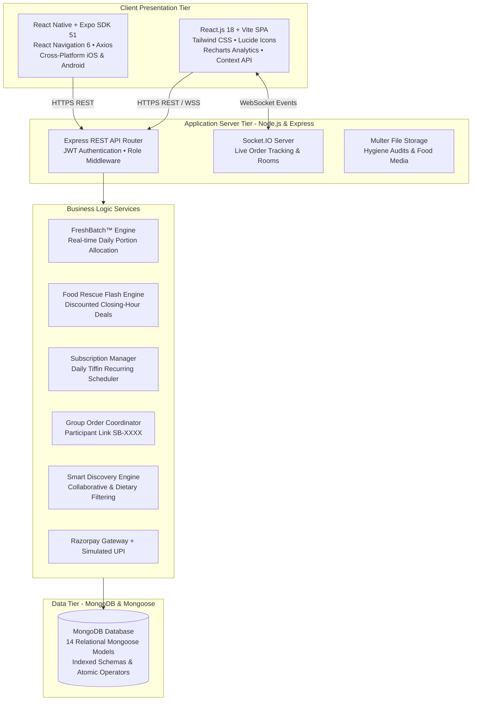

# SmartBite – Smart Food Ordering & Homemade Food Marketplace

> **"Homemade Happiness, Delivered Fresh"**  
> An MCA-level Major Project & Startup-ready Full-Stack Marketplace Platform connecting food lovers with verified home chefs, independent home kitchens, and traditional culinary artisans.

---

## 🌟 Executive Summary & Problem Statement

Urban lifestyles and commercial dining have led to increased dependency on mass-produced restaurant food, which often relies on artificial additives, excessive oil, and standardized taste. Simultaneously, countless talented homemakers and passionate home cooks possess rich culinary expertise in authentic regional delicacies (such as North Karnataka Jolada Rotti, Akki Rotti, Thatte Idli, Ragi Mudde, and traditional slow-cooked thalis) but lack the digital infrastructure, distribution network, and verified credibility to monetize their culinary skills.

**SmartBite** solves this two-sided problem by creating a trusted, community-centric homemade food marketplace featuring:
- **Zero Food Waste** via the innovative **FreshBatch™** portion tracking and **Food Rescue Deals**.
- **Daily Meal Subscriptions** (Breakfast, Lunch, Dinner Tiffin Plans) for students and working professionals.
- **Collaborative Group Orders** with shareable invite codes for families and office teams.
- **Verified Home Kitchens** backed by administrative FSSAI compliance audits and hygiene reviews.
- **Rule-Based Smart Food Discovery** personalized to dietary choices and past cravings.

---

## 🛠️ Technology Stack Architecture



### Detailed Stack Specifications
- **Web Frontend:** React.js 18, Vite 5, Tailwind CSS, React Router DOM v6, Axios, Lucide React, Recharts (Admin & Seller dashboards), Context API for global auth & cart.
- **Mobile Application:** React Native, Expo SDK 51, React Navigation 6 (Bottom Tabs & Native Stack), Axios, Vector Icons.
- **Backend Runtime:** Node.js, Express.js REST API with centralized error handler and async wrappers.
- **Database:** MongoDB, Mongoose ODM with custom schema methods, validation hooks, cascading populates, and atomic `$inc` updates.
- **Real-Time Communication:** Socket.IO for live kitchen-to-customer order tracking and instant order status dispatch.
- **Payment Infrastructure:** Razorpay test mode integration + Built-in Simulated Payment gateway (UPI, NetBanking, COD) for presentation and testing without external API credentials.
- **Security & Authorization:** JWT (JSON Web Tokens), bcryptjs (salt rounds 10), Role-Based Access Control (RBAC) across `customer`, `seller`, and `admin`.

---

## 👥 Three Comprehensive User Roles

### 1. Customer
- **Discovery & Search:** Browse authentic regional homemade foods with live search, pure veg/non-veg filters, category filters, and rating filters.
- **Kitchen Transparency:** Inspect chef credentials, cooking experience, service areas, hygiene ratings, allergen notices, and ingredient lists.
- **FreshBatch Portions:** Real-time visibility into how many fresh portions remain for today.
- **Seamless Cart & Checkout:** Single-kitchen cart validation, promo coupon engine (`SMART50`, `HOMELOVE`), simulated UPI / COD / Razorpay payments.
- **Order Tracking:** Live 5-step visual tracking timeline powered by Socket.IO (`placed` ➔ `confirmed` ➔ `preparing` ➔ `ready` ➔ `out_for_delivery` ➔ `delivered`).
- **Special Programs:** Subscribe to daily meal tiffins, participate in Community Group Orders, and claim discounted Food Rescue Deals.
- **Profile & Feedback:** Manage saved addresses, view past orders, and leave star ratings and reviews.

### 2. Home Chef / Seller
- **Kitchen Profile Setup:** Manage kitchen name, biography, FSSAI registration number, kitchen photos, and operating hours.
- **Food Product Lifecycle:** Add/edit homemade dishes, upload images, set prices, preparation time, ingredient lists, and allergen tags.
- **FreshBatch™ Control:** Set maximum daily portion limits per dish and watch portions decrease automatically upon orders.
- **Food Rescue Activator:** Mark leftover portions as rescue deals with custom discount percentages and claim deadlines before closing.
- **Order Management:** Accept/reject incoming orders in real time, update cooking progress, and dispatch status changes.
- **Financial Analytics:** Track gross merchandise value (GMV), net earnings (after 10% platform commission), and customer reviews with reply capability.

### 3. Administrator
- **Executive Platform Analytics:** Real-time GMV, total customer count, registered home chefs, platform commission revenues, and category sales charts.
- **Seller Verification Audits:** Review pending home chef applications, inspect FSSAI compliance declarations, and approve/reject kitchen badges.
- **User Management:** Oversee all customers and home chefs, activate or suspend accounts.
- **Menu & Order Oversight:** Monitor active platform-wide food listings, track stuck orders, and manage discount promo coupons.
- **Customer Care & Complaints:** Resolve customer grievance tickets and platform disputes.

---

## 💡 6 Unique SmartBite Startup Features

| Feature | Technical Architecture & Implementation | Real-World Benefit |
| :--- | :--- | :--- |
| **1. FreshBatch™** | Portions are modeled as atomic counters (`dailyPortionLimit`, `availablePortions`). Checkout uses MongoDB atomic `$inc: { 'freshBatch.availablePortions': -qty }` with pre-condition `availablePortions >= qty`. | Prevents home cooks from being overwhelmed; guarantees customers receive food cooked in small, authentic batches. |
| **2. Daily Meal Subscriptions** | Recurring plan model (`breakfast`, `lunch`, `dinner`) supporting 7-day weekly and 30-day monthly cycles with designated delivery time slots. | Guarantees predictable daily income for home chefs and affordable, wholesome food for students & professionals. |
| **3. Food Rescue Deals** | Automated discount engine allowing home cooks to flag unsold daily batches at 30%–50% off with expiry timers before kitchen closing. | Directly combats urban food waste while offering budget-friendly gourmet homemade meals. |
| **4. Community Group Orders** | Unique shareable group code (`SB-XXXXXX`) enabling multiple coworkers or neighbors to add individual items into a synchronized single checkout. | Reduces delivery footprint, cuts delivery costs, and fosters community dining. |
| **5. Verified Home Kitchen** | Three-tier verification status (`pending`, `approved`, `rejected`) linked to FSSAI certificates, hygiene audits, and admin approvals. | Eliminates consumer anxiety about cleanliness and sanitation in domestic kitchens. |
| **6. Smart Food Discovery** | Rule-based recommendation engine scoring dishes based on customer dietary flags (veg/non-veg), historical categories, and regional preferences. | Surfaces relevant local dishes quickly without overwhelming users with irrelevant options. |

---

## 🗄️ Database Schemas (14 Mongoose Models)

1. **User:** Name, email, password (bcrypt), phone, role (`customer`, `seller`, `admin`), avatar, food preferences (veg only, allergies, cuisines), active status.
2. **SellerProfile:** Reference to User, kitchen name, bio, kitchen photos, FSSAI registration number, hygiene audit rating, verification status, service areas, operating hours, kitchen open switch.
3. **Food:** Reference to Seller & Category, name, description, foodType (`veg`/`non-veg`), price, images, ingredients, allergens, preparation time, FreshBatch details (`dailyPortionLimit`, `availablePortions`), Rescue Deal details (`active`, `discountedPrice`, `deadline`).
4. **Category:** Name, slug, icon, description, active status.
5. **Cart:** Reference to Customer & Seller (enforcing single-kitchen ordering), array of items with quantities and rescue flags, cached totalPrice.
6. **Order:** Unique orderNumber (`SB-XXXX`), Customer & Seller refs, item breakdown, pricing (subtotal, delivery fee, platform fee, coupon discount, grand total), payment details, order status timeline, delivery address.
7. **Payment:** Order ref, User ref, payment gateway (`razorpay`, `simulated_upi`, `cod`), status (`captured`, `pending`, `failed`), transaction ID.
8. **Subscription:** Customer & Seller refs, planName, mealType (`breakfast`, `lunch`, `dinner`), durationDays, timeSlot, deliveryAddress, status (`active`, `paused`, `completed`).
9. **GroupOrder:** Shareable code (`SB-GRP-XXXX`), host ref, participant list with individual dish selections, total pool amount, checkout status.
10. **Review:** Food & Seller refs, Customer ref, rating (1–5), comment, photos, home chef response.
11. **Coupon:** Code (`SMART50`, `HOMELOVE`), discountType (`percentage`, `flat`), discountValue, minimumOrderAmount, validUntil, usageCount.
12. **Notification:** User ref, title, message, type (`order`, `system`, `promo`), isRead flag.
13. **Address:** User ref, label (`Home`, `Work`), street, city, state, pincode, isDefault.
14. **SupportTicket:** User ref, subject, description, priority (`low`, `medium`, `high`), status (`open`, `resolved`), responses.

---

## 📱 Complete Screen & Page Inventory

### Web Application (42 Production Pages)
- **Public (11):** Landing Page, About Us, Explore Food, Home Chefs, Food Details, Chef Details, Login, Register, Become a Home Chef, Contact Us, FAQ.
- **Customer (11):** Customer Dashboard, My Profile, My Cart, Checkout, My Orders, Live Order Tracking, Favourite Foods, Meal Subscriptions, Group Orders, Food Rescue Deals, Reviews & Ratings.
- **Home Chef / Seller (10):** Seller Dashboard, Kitchen Profile, Add Homemade Food, Manage Food Menu, Manage Orders, Manage Subscriptions, FreshBatch™ Control, Earnings & Payouts, Chef Reviews, Verification Status.
- **Administrator (10):** Admin Master Dashboard, Manage Customers, Manage Sellers, Seller Verification Audits, Manage Food Listings, Manage All Orders, Manage Categories, Manage Promo Coupons, Platform Reports & Analytics, Customer Complaints & Disputes.

### Mobile Application (14 Expo Screens)
- `SplashScreen.js`
- `LoginScreen.js`
- `RegisterScreen.js`
- `HomeScreen.js`
- `ExploreScreen.js` (with live dietary & search filters)
- `FoodDetailScreen.js` (with FreshBatch inventory meter)
- `ChefDetailScreen.js` (with FSSAI verification badge)
- `CartScreen.js` (with coupon engine)
- `CheckoutScreen.js` (with simulated UPI / COD options)
- `OrderTrackingScreen.js` (live visual timeline)
- `MyOrdersScreen.js` (order history & status badges)
- `MealSubscriptionsScreen.js` (curated daily tiffin plans)
- `FoodRescueScreen.js` (closing-time flash discounts)
- `ProfileScreen.js` (user settings & kitchen banner)

---

## 🚀 Step-by-Step Installation & Run Guide

### Prerequisites
- **Node.js:** v18.x or v20.x installed.
- **MongoDB:** Local MongoDB community service running at `mongodb://127.0.0.1:27017` OR a MongoDB Atlas connection string.
- **Git**

---

### Step 1: Clone Repository & Setup Monorepo
```bash
git clone https://github.com/your-username/smartbite.git
cd d:\Mernova
```

---

### Step 2: Backend Setup & Seed Data
```bash
cd backend
npm install

# Verify backend environment configuration (.env)
# MONGO_URI=mongodb://127.0.0.1:27017/smartbite
# PORT=5000
# JWT_SECRET=smartbite_super_secret_jwt_key_2026

# Seed initial authentic Indian homemade dishes, chefs, coupons, and orders:
npm run seed

# Start backend development server (Port 5000)
npm run dev
```

---

### Step 3: Frontend Web Setup
Open a new terminal:
```bash
cd frontend
npm install

# Start Vite development server (Port 5173)
npm run dev
```
Open [http://localhost:5173](http://localhost:5173) in your browser.

---

### Step 4: Mobile Application Setup
Open a new terminal:
```bash
cd mobile
npm install

# Launch Expo development server:
npm start

# Options:
# Press 'w' to run in web browser
# Press 'a' to run in connected Android device/emulator
# Press 'i' to run in iOS simulator
# Or scan QR code with Expo Go app on your physical smartphone
```

---

### Step 5: Run Automated End-to-End Verification Suite
You can verify the entire full-stack integration at any time by running:
```bash
cd backend
node test-e2e.js
```
This script automatically executes:
1. Backend health probe (`/api/health`)
2. Customer login & JWT authentication
3. Admin login & RBAC check
4. FreshBatch stock attributes inspection
5. Smart recommendation engine execution
6. Cart addition with portion limit verification
7. Coupon validation (`SMART50`)
8. Atomic order placement with automatic portion decrement
9. Simulated instant payment capture
10. Order status transitions
11. Admin analytics metrics retrieval

---

## 🔑 Pre-Seeded Demo Credentials

All seeded accounts share the default password: **`smartbite123`**

| Role | Email Address | Password | Access Capabilities |
| :--- | :--- | :--- | :--- |
| **System Admin** | `admin@smartbite.com` | `smartbite123` | Complete administrative dashboard, seller audits, GMV analytics, user status toggles. |
| **Home Chef (Seller)** | `seller@smartbite.com` | `smartbite123` | Sunitha's Kitchen (North Karnataka Thali, Jolada Rotti, FreshBatch manager, incoming orders). |
| **Home Chef (Seller)** | `gangamma@smartbite.com` | `smartbite123` | Gangamma's Heritage Kitchen (Thatte Idli, Akki Rotti, Ragi Mudde). |
| **Customer** | `customer@smartbite.com` | `smartbite123` | Rahul Sharma (Active cart, order tracking, meal subscriptions, rescue deals). |
| **Customer** | `pooja@smartbite.com` | `smartbite123` | Pooja Hegde (Pure vegetarian preference, South Indian cravings). |

*(Note: The Web Login screen includes one-click demo login buttons for instant role switching without typing credentials).*

---

## 🔒 Security & Best Practices

1. **Password Hashing:** Implemented with `bcryptjs` and pre-save hooks with work factor 10.
2. **Server-Side Price Calculation:** The frontend cart cannot manipulate item prices. All totals, taxes, discounts, and delivery fees are recomputed securely on the server.
3. **Atomic Inventory Protection:** Prevents over-ordering beyond available FreshBatch portions using MongoDB atomic conditions.
4. **JWT Bearer Protection:** Route protection middleware decodes and verifies tokens, blocking unauthenticated access to user/chef/admin APIs.
5. **No Hardcoded Payment Secrets:** Razorpay keys are loaded strictly from environment variables. If placeholder keys are present, the system cleanly defaults to simulated payment verification.

---

## 📄 License & Academic Attribution
Developed as an **MCA Major Project**. Licensed under the **MIT License**. Free for academic and demonstration purposes.
